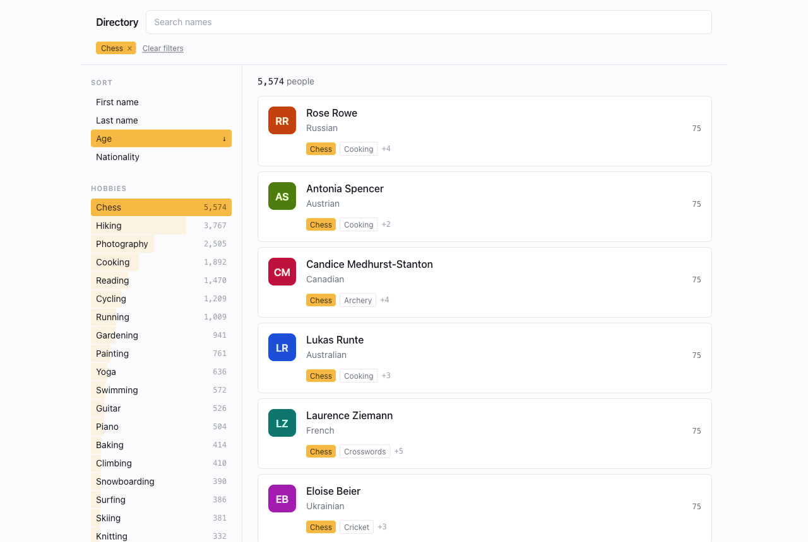

# User Directory

A searchable, filterable directory of 50,000 people. React client, Express API, SQLite as the
source of truth. The original exercise brief is preserved at [`docs/EXERCISE.md`](docs/EXERCISE.md).



## Quick start

Requires Node 22+ and Yarn 1.

```bash
yarn install
yarn seed     # creates server/data/app.db with 50,000 users (~1s)
yarn dev      # API on :4000, client on :5173
```

Open <http://localhost:5173>. Vite proxies `/api` to the server, so local development uses the same
single-origin model as the Docker setup and CORS is never involved.

## Docker

```bash
docker compose up --build
```

Open <http://localhost:8080>. If that port is taken, use `WEB_PORT=8081 docker compose up --build`.

The server seeds the database on first boot and stores it on a named volume, so restarts reuse it
rather than re-seeding. The web container serves the built SPA through nginx and proxies `/api` to
the API container; compose gates the SPA on the API's healthcheck so it never loads against a
database that is still being written.

To start over from an empty database: `docker compose down -v`.

## Commands

| Command | Description |
| --- | --- |
| `yarn dev` | Run the API and client together |
| `yarn seed` | Create and populate `server/data/app.db` |
| `yarn seed --users=1000` | Seed a smaller dataset |
| `yarn test` | Run the test suite (129 tests) |
| `yarn typecheck` | Typecheck both packages |
| `yarn build` | Build both packages |

## How it works

### One query behind everything

A single `matched` CTE is built from the active filter state, and all four outputs derive from it:
the page of users, the total, the top-20 hobbies, and the top-20 nationalities.

```sql
WITH matched AS (
  SELECT u.id, u.avatar, u.first_name, u.last_name, u.age, u.nationality
  FROM users u
  WHERE (u.first_name LIKE :t0 ESCAPE '\' OR u.last_name LIKE :t0 ESCAPE '\')
    AND u.nationality IN (:n0, :n1)
    AND u.id IN (
      SELECT uh.user_id FROM user_hobbies uh
      WHERE uh.hobby_id IN (SELECT id FROM hobbies WHERE name IN (:h0, :h1))
      GROUP BY uh.user_id
      HAVING COUNT(DISTINCT uh.hobby_id) = :hobbyCount
    )
)
```

Sharing one definition is what makes "the facet counts reflect the active filters" true by
construction rather than by keeping two queries in sync by hand.

Three details that are easy to get wrong:

- **Text search is tokenised.** Each whitespace-separated token must match the first *or* last name,
  and tokens are ANDed, so `jo smi` finds Joe Smith. A single `LIKE` across both columns returns
  nothing for any two-word query.
- **`HAVING COUNT(...) = :hobbyCount` uses the requested count, not the resolved one.** Asking for
  `hobbies=Chess,Bogus` must match nobody. Counting resolved ids would silently drop the missing
  filter and return every chess player.
- **LIKE metacharacters are escaped**, so searching `50%` is a literal search.

### Schema

Hobbies are normalised; nationality is a plain indexed column on `users`.

That asymmetry is deliberate. Nationality is a low-cardinality scalar (45 values), and keeping it on
the row lets one composite index serve both `ORDER BY nationality` and the facet `GROUP BY`. A
lookup table would force a join into every sort path and turn the ordering into a filesort for no
schema benefit. Hobbies are a genuine many-to-many relation, so they get a join table.

Every sort index is `(column, id)` so the `id` tie-breaker rides the same index as the primary
ordering. `COLLATE NOCASE` is declared at column level, so the indexes are built with that collation
and `alice` sorts next to `Alice` rather than after `Zoe`.

### Pagination

Keyset, not offset. The cursor holds the last row's sort value and id, and the `WHERE` mirrors the
`ORDER BY` exactly:

```
asc:   (col > :v) OR (col = :v AND id > :i)      ORDER BY col ASC,  id ASC
desc:  (col < :v) OR (col = :v AND id > :i)      ORDER BY col DESC, id ASC
```

`id` is the final tie-breaker in both directions, which makes the ordering a total order and
duplicates or gaps across pages structurally impossible. Each request asks for `limit + 1` rows;
whether the extra row comes back is what `has_more` means, which stays correct on the final page and
does not depend on `total`.

Cursors carry a short fingerprint of the filter and sort set. Replaying one against different
filters returns `400 INVALID_CURSOR` instead of quietly emitting wrong rows.

### Two endpoints, not one

Facets depend on the filters but not on sort or cursor. Keeping them separate means scrolling to
page 12 does not recompute two `GROUP BY`s, and re-sorting does not touch the sidebar at all — the
client's facet query key deliberately excludes the sort.

### Client

Filter state lives in the URL and nowhere else. `useDirectoryParams` is the only reader and writer,
so shareability is not layered on afterwards — it is the storage mechanism, and a reload cannot
disagree with what is on screen. Defaults are omitted from the query string. Typing replaces history
entries so Back undoes a filter rather than a keystroke; filter and sort changes push.

The same constants validate on both sides, but the two use them differently on purpose: the server
rejects a bad `sort` with 400, while the client falls back to the default so a stale or hand-edited
link still renders.

The list is virtualised with `@tanstack/react-virtual`. Scrolling through 50,000 people keeps a flat
~24 cards in the DOM.

## API

### `GET /api/users`

| Param | Type | Default |
| --- | --- | --- |
| `q` | string, tokenised across both name fields | — |
| `nationalities` | comma-separated, **OR** semantics | — |
| `hobbies` | comma-separated, **AND** semantics | — |
| `sort` | `first_name` \| `last_name` \| `age` \| `nationality` | `first_name` |
| `order` | `asc` \| `desc` | `asc` |
| `limit` | 1–100 | 50 |
| `cursor` | opaque, from `page_info.next_cursor` | — |

```jsonc
{
  "data": [
    {
      "id": 48819, "avatar": "/api/avatars/JB-10.svg",
      "first_name": "Julie", "last_name": "Bode",
      "age": 74, "nationality": "Korean",
      "hobbies": ["Birdwatching", "Chess", "Hiking"]
    }
  ],
  "page_info": { "total": 42, "returned": 1, "has_more": true, "next_cursor": "eyJ2Ijo3NCwi…" }
}
```

### `GET /api/facets`

Accepts `q`, `nationalities`, and `hobbies`. Anything else is rejected, since nothing else affects
the counts.

```jsonc
{
  "hobbies":       [{ "value": "Chess", "count": 42 }],
  "nationalities": [{ "value": "Japanese", "count": 23 }]
}
```

Both lists cap at 20 and order by `count DESC, value ASC` so ties are deterministic. The two count
different things, and both are correct: hobby counts sum to hobby *assignments* among matched users,
nationality counts sum to matched *users*.

### `GET /api/avatars/:initials-:hue.svg`

Renders a deterministic SVG from the path alone, without touching the database, and serves it
`immutable`. Serving avatars locally rather than from a photo service keeps the app working with no
network and stops 50,000 remote image fetches competing with the virtualiser during fast scrolling.

### `GET /api/health`

`{ "status": "ok", "users": 50000 }` — also the compose healthcheck target.

### Errors

```jsonc
{ "error": { "code": "INVALID_QUERY", "message": "…", "details": [] } }
```

`INVALID_QUERY` (400), `INVALID_CURSOR` (400), `NOT_FOUND` (404), `INTERNAL` (500). Unexpected
failures are logged in full but reported generically.

## Decisions and trade-offs

**Facet counts apply every active filter.** The brief says the top-20 lists must reflect the current
text filter and selected filters, so all of them apply to both lists. One consequence is worth
naming: selecting a nationality collapses the nationality list to that single row, because the
matched set now contains only those users, so a second nationality cannot be discovered from the
sidebar. Standard faceted search avoids this by computing an OR facet with every filter *except* its
own selection, but that reads as ignoring the requirement the brief states explicitly. Selected
values are pinned in their group so an active filter can always be removed even if it falls outside
the top 20.

**SQLite comes from Node's built-in `node:sqlite`** rather than `better-sqlite3`. There is no native
module to compile, so installs are instant, the Docker image needs no build toolchain, and there is
no prebuild-download step to fail on a restricted network. It is still marked experimental in Node
22, which the `--disable-warning` flag in the npm scripts acknowledges.

**The seed generator is a runtime dependency.** The container seeds its own database on first boot,
so `@faker-js/faker` genuinely ships with the image rather than being a build-time tool.

**Sort is a list of rows, not a `<select>`.** macOS renders a native select's popup at the system
font size regardless of the element's own, so it cannot be made to match the rest of the sidebar.

**Measured latency**, 50,000 users and 207,253 hobby links, on an M-series laptop:

| Request | Time |
| --- | --- |
| `GET /api/users?limit=50` | 5 ms |
| `GET /api/users` + text filter + sort | 8 ms |
| `GET /api/facets` (no filters) | 24 ms |
| `GET /api/facets` + text + hobby filter | 8 ms |
| Seeding 50,000 users | ~0.9 s |

The unfiltered facet query originally took 106 ms. Two changes brought it down: the hobby facet uses
`WHERE uh.user_id IN (SELECT id FROM matched)` instead of a join, which lets SQLite build a bloom
filter over the matched ids (about 10× faster once a filter is active), and with no filters at all
the CTE is skipped entirely so the count can scan the already-grouped `(hobby_id, user_id)` covering
index.

## Tests

```bash
yarn test
```

129 tests. The server suite runs against an in-memory database built from a 40-user fixture that is
hand-written so every expectation can be checked by reading it — it contains repeated ages and
names, users with zero and with ten hobbies, LIKE metacharacters in a name, mixed-case names, and
more than twenty distinct hobbies and nationalities so the top-20 cap is genuinely exercised.

The load-bearing case walks every page under all four sorts in both directions and asserts the
collected ids are unique and complete, and that paginated order matches unpaginated order. The same
walk has been run over HTTP against the full 50,000-user dataset: 28 pages per sort, 2,791 rows
every time, no duplicates and no gaps.

## Project structure

```
docs/EXERCISE.md          the original brief
docker-compose.yml
client/
  Dockerfile              vite build → nginx
  nginx.conf              SPA fallback + /api proxy
  src/
    api/                  fetch wrapper, query hooks
    state/                URL <-> filter state
    directory/            page, search, sort, sidebar, list, card, states
server/
  Dockerfile
  docker-entrypoint.sh    seed on first boot, then start
  src/
    db/                   schema, connection, migration
    seed/                 vocabularies and the seed CLI
    users/                filters, page query, facet query, cursors, router
    avatars/              deterministic SVG route
    shared/contract.ts    API types and constants, shared with the client
    common/               query parsing and error handling
  tests/
```

The client imports the API contract from `server/src/shared/contract.ts` through a Vite alias. It
holds types and constants only and has no dependencies, so there is one definition of the response
shapes and the sort-field values with no runtime coupling between the packages.
